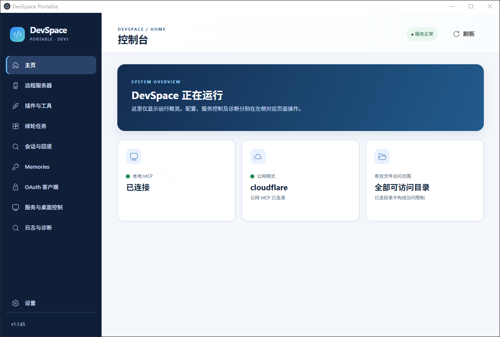

# DevSpace Portable

DevSpace Portable 是 Windows 上的便携式控制中心。它把本地项目和远程 Linux 工作区接入 ChatGPT、Codex 等 MCP 客户端，也能用自己配置的本地或云端模型执行 Agent 任务。

[下载最新正式版](https://github.com/E3N-glotm/DevSpace-Deploy-Portable/releases/latest) · [安装与使用](README-PORTABLE.md) · [Agent 工作台](docs/AGENT-WORKBENCH.md) · [更新记录](CHANGELOG.md)

## 快速开始

1. 在 [GitHub Releases](https://github.com/E3N-glotm/DevSpace-Deploy-Portable/releases/latest) 下载 `DevSpacePortable-Windows-x64-<版本>.zip`。这是 Windows 10 / 11 x64 的运行包。
2. 将整个 ZIP 解压到固定目录，例如 `D:\DevSpacePortable`。运行 `DevSpace-Portable.exe`，按向导选择网络方式、文件访问范围和操作权限。
3. 本机使用可选本地模式。需要从 ChatGPT 网页端连接时，可配置 ngrok 或 Cloudflare Tunnel，并在控制中心核对公网状态。
4. 把控制中心提供的 `https://你的域名/mcp` 添加到可用的 ChatGPT 自定义 MCP 连接。首次 OAuth 授权时，在 DevSpace 授权页使用 Owner Password。具体入口以账户和工作区可用功能为准。[OpenAI 连接文档](https://help.openai.com/en/articles/12584461-connecting-custom-mcp-servers-in-chatgpt)

GitHub 的 **Source code** 是开发用源码。安装、隧道设置和常见故障见 [使用指南](README-PORTABLE.md)。

## 常用入口

| 要做的事 | 在哪里操作 |
| --- | --- |
| 连接 Windows 项目 | 在「设置 → 文件访问」添加工作目录，在 MCP 客户端打开该目录 |
| 连接 Linux 服务器 | 在「远程服务器」部署 Agent，再打开 `devspace://<Agent 名称或 ID>/absolute/linux/path` |
| 配置模型、模型组与全局调度 | 打开「模型提供商」，保存端点和模型，按需配置 Worker、Reviewer、Planner |
| 运行或查看委派任务 | 在「Agent 工作台」新建任务、查看工具记录和结果。也可由 ChatGPT 经 DevSpace MCP 委派 |
| 使用 Windows 桌面和浏览器 | 在本机授权 Computer Use，保持交互桌面可用。可操作鼠标键盘、获取截图、读取支持的浏览器页面结构 |
| 升级已安装版本 | 打开「设置 → 更新」，检查、下载并确认安装 |

DevSpace 本地 MCP 默认监听 `127.0.0.1:7676`。公网接入使用已经配置的 HTTPS 隧道与 OAuth。文件范围、操作权限、远程 Agent 授权和 Computer Use 开关可分别管理。[权限与安全说明](SECURITY.md)

## 文档

- [安装、连接、升级与排查](README-PORTABLE.md)
- [模型提供商、模型组与 Agent 工作台](docs/AGENT-WORKBENCH.md)
- [1.1.69 正式版说明](docs/releases/HOTFIX-1.1.69.md) · [版本记录](CHANGELOG.md)
- [开发指南](docs/DEVELOPMENT.md) · [发行流程](docs/RELEASING.md) · [参与维护](CONTRIBUTING.md)

使用问题与功能建议可提交到 [GitHub Issues](https://github.com/E3N-glotm/DevSpace-Deploy-Portable/issues)。漏洞请按 [安全政策](SECURITY.md) 私下报告。

Portable 集成代码采用 [MIT 许可证](LICENSE)。上游软件和运行时组件遵循各自许可证，详见 [第三方许可说明](THIRD-PARTY-NOTICES.md)。
