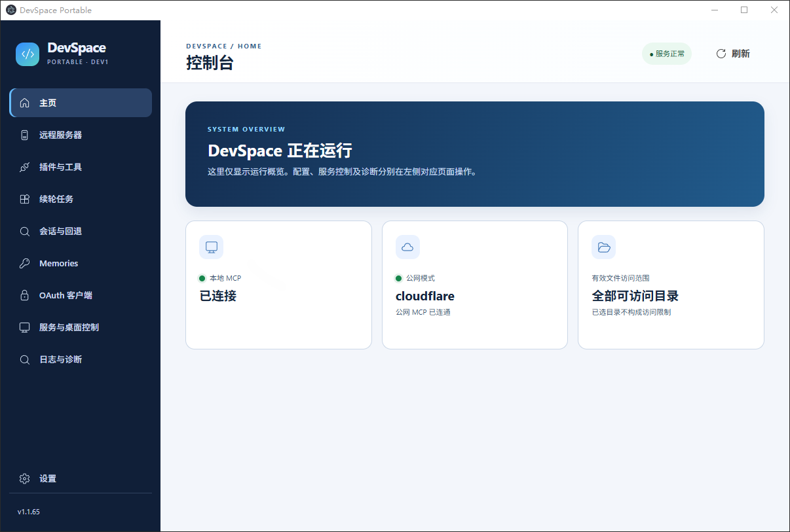

# DevSpace Portable

**在 Windows 上部署、管理并安全连接 DevSpace MCP 的便携式桌面应用。** 一个控制中心即可管理本地工作区、远程 Linux Agent、ChatGPT/Codex 连接、插件、Computer Use 和在线更新。

[下载最新正式版](https://github.com/E3N-glotm/DevSpace-Deploy-Portable/releases/latest) · [版本更新记录](CHANGELOG.md) · [问题反馈](https://github.com/E3N-glotm/DevSpace-Deploy-Portable/issues) · [English / Development](docs/DEVELOPMENT.md)



> 上图为桌面控制中心界面。**正式版以 GitHub Releases 中最新的非预发布版本为准**，不要将源码中的开发标识或尚未完成的工作流视为已发布版本。

## 可以做什么

| 能力 | 作用 |
| --- | --- |
| Windows 便携部署 | 解压即用，集中管理 MCP 服务、权限、配置、日志及启动任务 |
| ChatGPT / Codex 接入 | 通过 HTTPS 隧道及 OAuth 暴露受控的 `/mcp` 端点 |
| 远程 Linux Agent | 连接多台 Linux 服务器；支持公网或受信任局域网连接、SSH 安装与故障恢复 |
| Computer Use | 经本机授权后操作 Windows 桌面；支持截图和批量输入动作 |
| 工具与插件 | 统一管理工具权限、插件、持久进程、会话审阅与显式 Memories |
| 在线更新 | 检查新版本、显示下载/校验进度、优先复用差异数据、失败时回退 |

**架构概览**

```text
ChatGPT / Codex / 其它 MCP 客户端
          │  HTTPS + OAuth
          ▼
  公网隧道（ngrok / Cloudflare）
          │
          ▼
Windows DevSpace Portable（127.0.0.1:7676）
          ├── Windows 本地工作区、Git、进程与文件
          ├── Computer Use、插件与显式 Memories
          └── Linux Agent ── Linux 允许访问的工作目录
```

普通情况下本机 MCP **只监听 loopback**；请通过实际配置的 HTTPS 域名连接，**不要将 7676 端口直接映射到公网**。

## 快速开始（Windows 10 / 11 x64）

1. 打开 [GitHub Releases](https://github.com/E3N-glotm/DevSpace-Deploy-Portable/releases/latest)，下载名称形如 `DevSpacePortable-Windows-x64-<版本>.zip` 的完整包。GitHub 自动生成的 **Source code (zip)** 不可直接运行。
2. 解压到固定目录（例如 `D:\DevSpacePortable`），运行 `DevSpace-Portable.exe`；**不要直接在 ZIP 内运行**。
3. 在控制中心设置本地工作目录及其访问权限。只授权真实需要使用的项目目录，初次使用建议选择 `workspace` 权限。
4. 如需网页端远程连接，选择 **ngrok** 或 **Cloudflare Tunnel**，填写对应账号/隧道的凭据及公网 HTTPS 根地址，保存并启动服务。
5. 核对控制中心报告的本地 MCP 和公网连接状态，再将 `https://你的域名/mcp` 添加到 ChatGPT 自定义 MCP App。

程序的首次部署、隧道建立和 OAuth 授权可能需要网络连通性与用户交互；具体状态以控制中心及诊断结果为准。

### 隧道怎么选？

| 连接方式 | 需要准备 | 适用场景 |
| --- | --- | --- |
| ngrok | ngrok Authtoken，以及分配给该账号的 HTTPS 域名 | 快速搭建公网 MCP 接入 |
| Cloudflare Tunnel | 有效的命名隧道 Token、已配置的公网主机名 | 已有 Cloudflare 域名/隧道的部署 |
| 本地 | Windows 本机的监听地址和端口 | 本机诊断、无需公网的调试 |

隧道的 **公网 HTTPS 根地址只填写 origin**，例如 `https://example.ngrok-free.app`，不追加 `/mcp`；对外提供的实际 MCP 端点才是 `https://example.ngrok-free.app/mcp`。ngrok Authtoken / Cloudflare Token 用于启动隧道，**不是** ChatGPT OAuth 授权页要求的 Owner Password。

### 连接 ChatGPT

在 ChatGPT 中打开可用的 **Apps / 自定义 MCP App** 设置，为 DevSpace 创建连接并填写控制中心提供的 HTTPS `/mcp` URL。首次 OAuth 授权时，在 DevSpace 授权页输入 **Owner Password** 并确认授权；不要将密码或 Token 粘贴到聊天、Issue、日志或公开仓库。

ChatGPT 自定义 App 的入口及可用权限可能随账号和产品版本变化，参见 [官方 MCP App 文档](https://help.openai.com/en/articles/12584461-developer-mode-and-full-mcp-connectors-in-chatgpt)。升级后若新增工具未出现，请在 ChatGPT 侧刷新/重新扫描工具。

## 连接远程 Linux 服务器

Windows 端继续承担唯一的 MCP/OAuth 控制面板；远程 Linux 机器只运行轻量 Agent，不需要单独暴露 MCP 服务。

在控制中心的 **远程服务器** 页面填写服务器名称、权限、安装目录和连接信息，按网络条件选择：

- **公网连接**：Agent 通过已配置的控制端 HTTPS/WebSocket 服务主动连接；适合不在同一局域网的服务器。
- **局域网连接**：在可信网络内使用 Agent LAN 端点，减少公网隧道依赖。该通道不提供 TLS，**不得直接向互联网开放**。
- **SSH 恢复 / 安装**：录入 SSH 主机、端口、账户及认证方式后，进行 Agent 安装、连接恢复或配置更新；恢复需通过新的连接/心跳校验。

实际访问 Linux 工作区时，路径格式为 `devspace://<Agent 名称或 ID>/absolute/linux/path`。Linux 端 `allowedRoots`、文件真实路径检查和运行用户权限仍然生效，远程连接并不自动获得 root 权限。

## 更新和恢复

在控制中心点击 **检查更新**：先对比本机版本和最新正式 Release，再执行下载、校验、暂存，确认后由独立的可见更新程序完成安装。更新过程提供传输量、速度、剩余时间及阶段状态；差异更新不可用时可回退到完整包。

**安装更新会短暂中断 DevSpace 服务**。如当前正在通过同一个 MCP 会话操作本机，需先保存任务状态，不要用将被停止的服务进程继续控制自身升级。更新器应保留现有 `data/`、OAuth 身份、插件、服务器配置及运行状态；出现异常请先查看可见更新窗口和日志，不要直接删除 `data/`。

源码 Git 工作区不会被应用级在线更新覆盖：开发人员应使用 Git 提交、分支和发布流程。

## 常见问题

**连接不上 / 公网状态显示异常？** 首先确认本地 MCP 已启动，再检查隧道 Token 与域名是否匹配、VPN/代理及网络连通性。公网健康状态可能受代理探测影响，不能单凭一个超时断言当前 MCP 会话已经断线。

**访问 `/mcp` 返回 401？** 无 OAuth Token 的请求返回 401 是正常鉴权行为。认证失败时应区分未授权、凭据失效和隧道断开；不要为了消除 401 而开放匿名访问。

**Remote Agent 离线？** 核对当前公网/局域网模式、目标主机地址及端口、Agent 心跳和 SSH 状态；必要时使用控制中心提供的 SSH 恢复，不要重复创建不同 Agent 身份。

**更新停止在下载或安装阶段？** 区分下载、哈希验证、解压和替换阶段，优先查看当前进度/错误信息。独立更新窗口负责在主界面退出后继续显示安装与回滚结果。

**能否授予整个磁盘权限？** 不建议。使用最小必要的 `allowedRoots`、`workspace` 权限和单独开关管理 Computer Use；`full-access` 只适用于明确理解风险的受控环境。

## 开发与发行

本仓库包含源码、测试和发行工具，不包含用户的 OAuth 凭据、配置数据库或完整 Portable 运行时。当前维护基线为 `Waishnav/devspace 1.0.7`，Portable 扩展位于本仓库的 `vendor/` 和 `setup/`。

```text
app/                       Node 运行时入口与依赖锁文件
ui-next/                   Electron + React 控制中心
vendor/waishnav-devspace/  维护的 Portable 核心源码
setup/                     原生启动器、更新程序、发行构建及测试
scripts/                   源码检查、环境初始化和发布辅助脚本
docs/releases/             各稳定版与开发版的具体说明
.github/workflows/         CI 和 GitHub Release 构建流水线
```

开发环境：Windows x64、Node.js `>=22.19 <27`、Python 3.11+、Git；完整构建还需要 UI 编译工具和可用的发行运行时。操作细节请参阅 [开发指南](docs/DEVELOPMENT.md)、[发行流程](docs/RELEASING.md) 与 [更新设计](docs/UPDATE-DESIGN.md)。

正式版通过 `vX.Y.Z` Git 标签触发 CI，只有 **测试通过且 GitHub Release 附件实际发布** 后才视为正式交付。完整包、blockmap、差异更新包、SHA-256 清单均以对应 Release 的下载页为准。

历史版本的详细说明保存在 [CHANGELOG](CHANGELOG.md) 与 [Release 文档目录](docs/releases/)；旧版长 README [已归档](docs/README-legacy-archive.md)，不再代表当前界面。

## 安全、许可证与反馈

不应将 `data/config`、OAuth/Token、SQLite、隧道凭据、日志、Computer Use 临时数据或完整已部署目录提交到 Git。核心服务通过权限规则限制文件/命令操作，Computer Use 需要本机显式授权。详见 [安全政策](SECURITY.md)。

原创 Portable 集成代码采用 [MIT License](LICENSE)；上游和打包工具仍遵循各自许可证，尤其应阅读 [第三方许可说明](THIRD-PARTY-NOTICES.md)。问题和功能建议请通过 [GitHub Issues](https://github.com/E3N-glotm/DevSpace-Deploy-Portable/issues) 提交，切勿附上敏感凭据。
